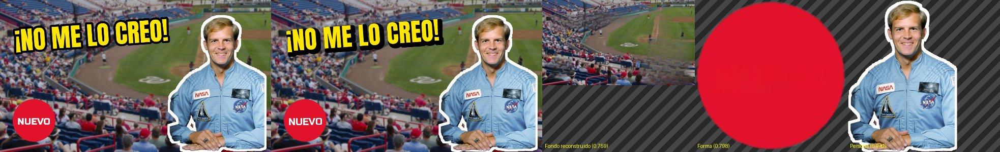
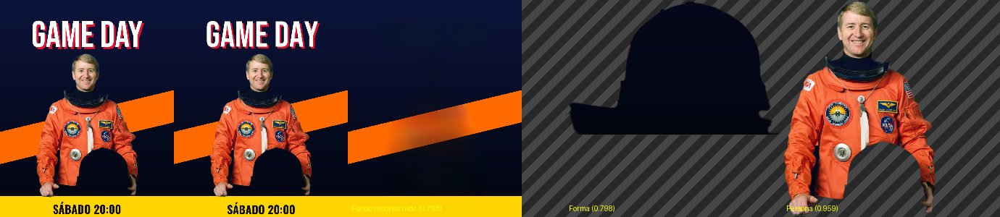
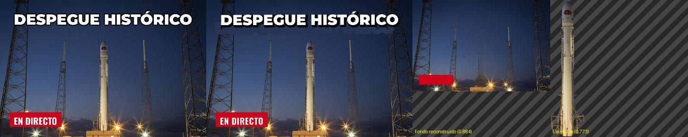
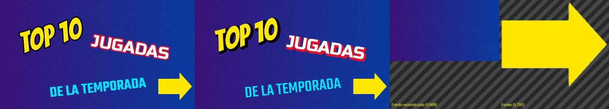
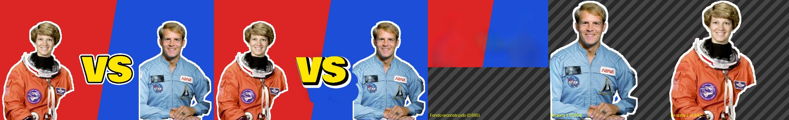
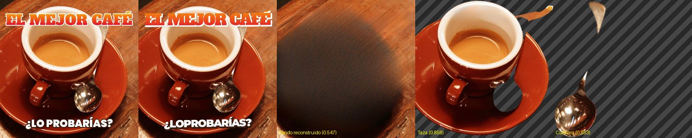
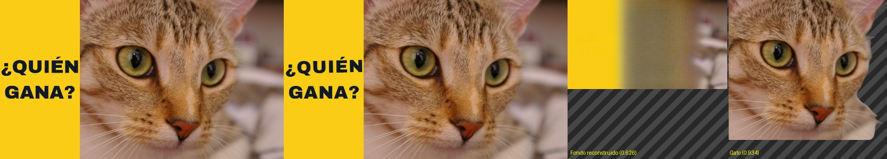

# Resultados de la descomposición

Equipo: CPU (cpu), 4 hilos, PyTorch 2.14.1+cpu.

| Imagen | s | SSIM | PSNR | Textos exactos | Similitud texto | Fuente top-1 | Fuente top-3 | ΔE relleno | Nº contornos ok | Sujetos | Gráficos | Textos como imagen |
|---|---|---|---|---|---|---|---|---|---|---|---|---|
| 01_miniatura_reaccion.jpg | 50.2 | 0.931 | 22.19 | 2/2 | 1.0 | 2/2 | 2/2 | 1.0 | 2/2 | 1 (esperados 1) | 1 (esperados 1) | 0 |
| 02_poster_deportivo.png | 40.9 | 0.962 | 21.98 | 2/2 | 1.0 | 2/2 | 2/2 | 0.0 | 2/2 | 1 (esperados 1) | 1 (esperados 2) | 0 |
| 03_fondo_complejo.jpg | 33.2 | 0.9329 | 22.13 | 2/2 | 1.0 | 2/2 | 2/2 | 0.5 | 2/2 | 1 (esperados 0) | 0 (esperados 1) | 0 |
| 04_textos_rotados.webp | 30.6 | 0.8844 | 18.49 | 3/3 | 1.0 | 3/3 | 3/3 | 0.9 | 3/3 | 0 (esperados 0) | 1 (esperados 1) | 0 |
| 05_dos_caras_vs.jpg | 34.7 | 0.9508 | 17.97 | 1/1 | 1.0 | 1/1 | 1/1 | 1.0 | 1/1 | 2 (esperados 2) | 0 (esperados 1) | 0 |
| 06_producto.jpg | 41.5 | 0.9094 | 18.43 | 1/2 | 0.981 | 1/2 | 1/2 | 13.9 | 2/2 | 2 (esperados 1) | 0 (esperados 0) | 0 |
| 07_mascota.png | 33.7 | 0.9819 | 26.99 | 2/2 | 1.0 | 2/2 | 2/2 | 0.0 | 2/2 | 1 (esperados 1) | 0 (esperados 1) | 0 |

## Detalle

### 01_miniatura_reaccion.jpg

Tiempos (s): {'textos': 8.31, 'relleno_textos': 4.82, 'sujetos': 33.07, 'graficos': 0.09, 'relleno_fondo': 3.16}

- «¡NO ME LO CREO!» → Anton, relleno #fee601, contornos ['#010101/11.0'], fidelidad 0.747, visible=True
- «NUEVO» → Russo One, relleno #fefdfd, contornos [], fidelidad 0.627, visible=True

### 02_poster_deportivo.png

Tiempos (s): {'textos': 8.99, 'relleno_textos': 3.64, 'sujetos': 23.8, 'graficos': 0.17, 'relleno_fondo': 3.54}

- «GAME DAY» → Bebas Neue, relleno #ffffff, contornos [], fidelidad 0.866, visible=True
- «SÁBADO 20:00» → Oswald, relleno #101010, contornos [], fidelidad 0.884, visible=True

### 03_fondo_complejo.jpg

Tiempos (s): {'textos': 6.21, 'relleno_textos': 2.78, 'sujetos': 20.42, 'graficos': 0.13, 'relleno_fondo': 2.97}

- «DESPEGUE HISTÓRICO» → Montserrat, relleno #ffffff, contornos ['#010102/7.0'], fidelidad 0.748, visible=True
- «EN DIRECTO» → Oswald, relleno #fefefd, contornos [], fidelidad 0.779, visible=True

### 04_textos_rotados.webp

Tiempos (s): {'textos': 5.82, 'relleno_textos': 2.29, 'sujetos': 20.9, 'graficos': 0.1, 'relleno_fondo': 0.65}

- «TOP 10» → Bangers, relleno #ffe700, contornos ['#010101/9.0'], fidelidad 0.729, visible=True
- «JUGADAS» → Russo One, relleno #ffffff, contornos ['#de142e/8.0'], fidelidad 0.736, visible=True
- «DE LA TEMPORADA» → Teko, relleno #00e5fe, contornos [], fidelidad 0.78, visible=True

### 05_dos_caras_vs.jpg

Tiempos (s): {'textos': 5.73, 'relleno_textos': 2.67, 'sujetos': 23.22, 'graficos': 0.1, 'relleno_fondo': 2.36}

- «VS» → Bowlby One, relleno #fee600, contornos ['#020201/9.0', '#fefefd/8.0'], fidelidad 0.747, visible=True

### 06_producto.jpg

Tiempos (s): {'textos': 7.12, 'relleno_textos': 5.03, 'sujetos': 24.0, 'graficos': 0.16, 'relleno_fondo': 4.06}

- «EL MEJOR CAFÉ» → Alfa Slab One, relleno #f88e0c, contornos ['#fffdfa/6.0'], fidelidad 0.804, visible=True
- «¿LOPROBARÍAS?» → Montserrat, relleno #ffffff, contornos ['#3a1d10/7.0'], fidelidad 0.752, visible=True

### 07_mascota.png

Tiempos (s): {'textos': 5.02, 'relleno_textos': 1.74, 'sujetos': 23.75, 'graficos': 0.14, 'relleno_fondo': 2.36}

- «¿QUIÉN» → Archivo Black, relleno #111827, contornos [], fidelidad 0.776, visible=True
- «GANA?» → Archivo Black, relleno #111827, contornos [], fidelidad 0.915, visible=True
